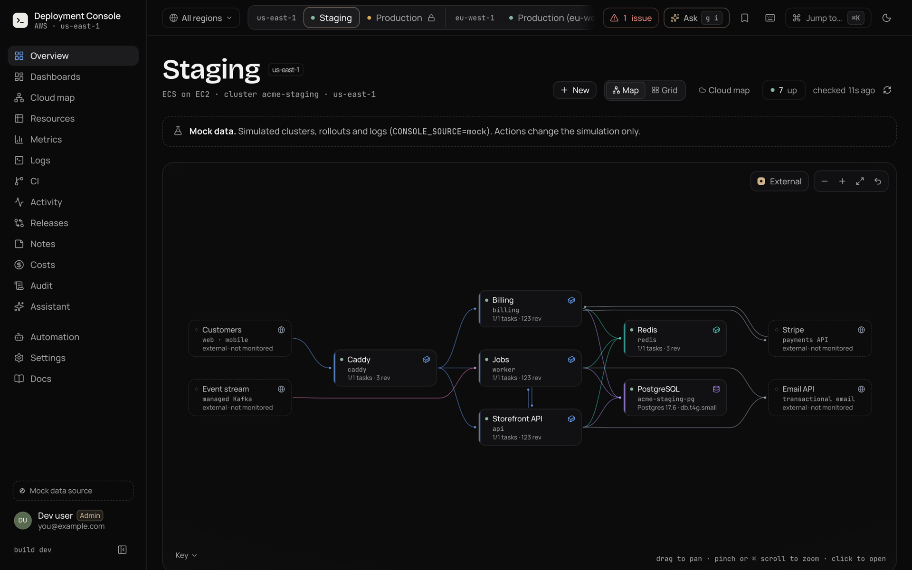
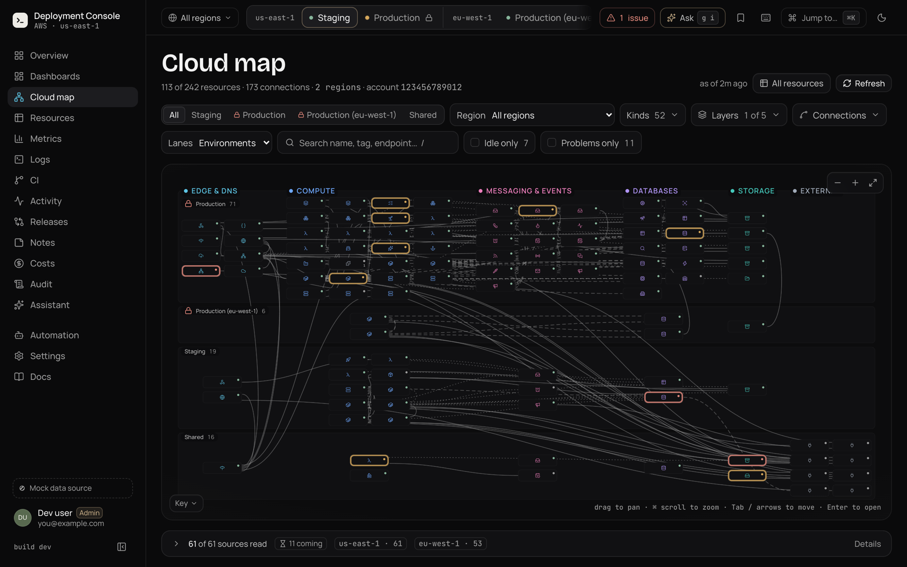
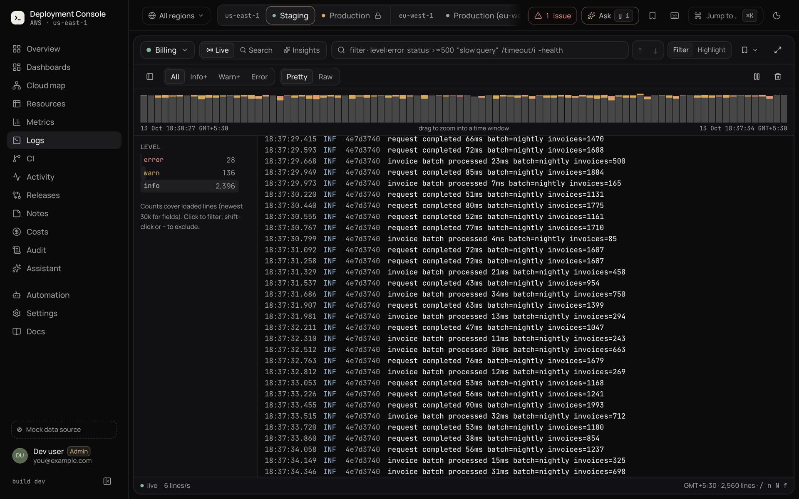
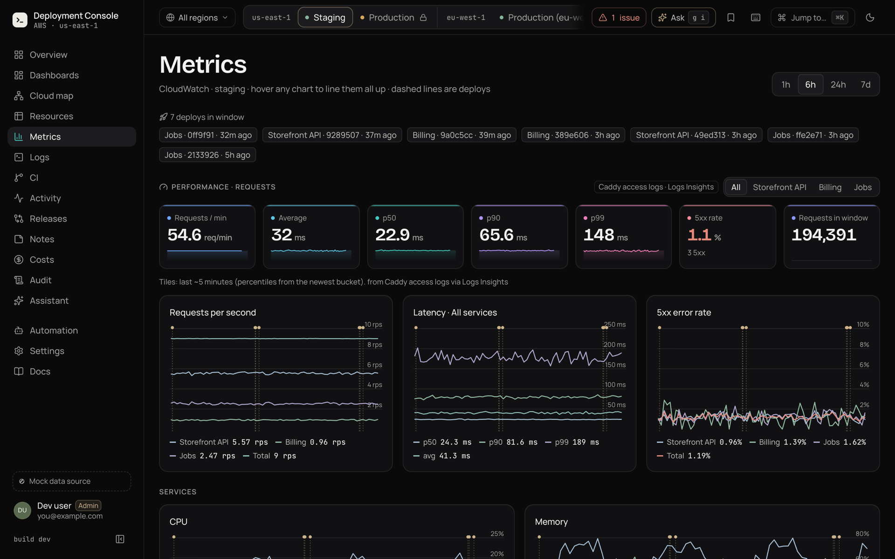
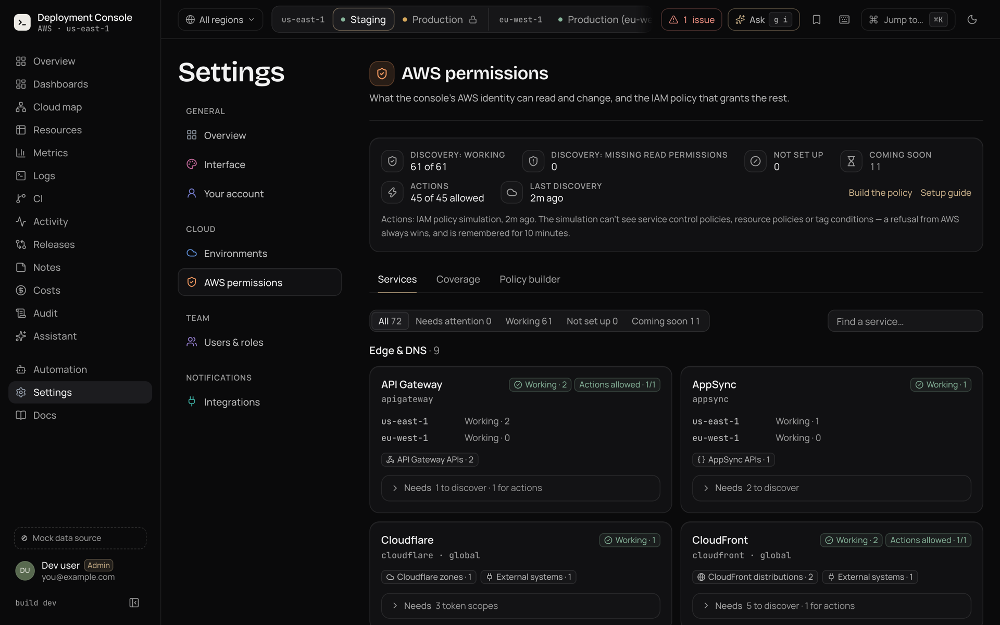
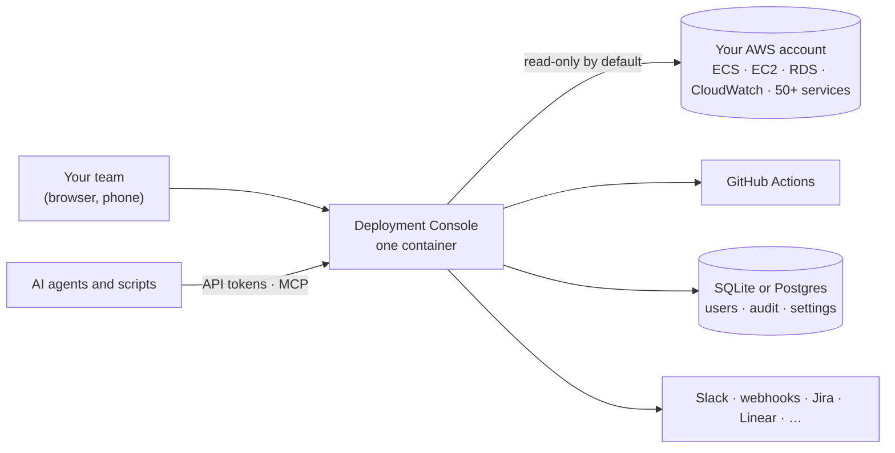

<div align="center">


# Deployment Console

**One self-hosted dashboard for your AWS.** See every environment, service, log and dependency in one place, and make
safe, audited changes, without giving everyone access to the AWS console.

[](LICENSE)
[](https://github.com/imharjot/deployment-console/actions/workflows/ci.yml)


[](CONTRIBUTING.md)

[**Try the demo**](#try-it-in-60-seconds) · [Connect AWS](#point-it-at-your-aws-account) · [Docs](docs/index.md) · [Deploy for your team](docs/deploy.md) · [Roadmap](#roadmap)



</div>

## Why

The AWS console is built for administrators. Most of your team only needs a few answers, fast: *Is it up? What
changed? What do the logs say? Can I restart it safely?* Answering those usually means handing out IAM access, SSH
keys and a tour of fifteen AWS pages.

Deployment Console reads your account and gives everyone one place for it:

- **Zero setup in your services.** Every ECS cluster becomes an environment, and services, databases, caches, load
  balancers and their connections are discovered from AWS. A docker compose box on EC2 can be an environment too.
- **Safe by default.** Start with a read-only IAM policy. Every change is guarded, role-checked, confirmed and written
  to an audit log. Production-like environments need a typed confirmation and a reason.
- **Yours.** One container in your own account, with your own IAM role and its own database. No SaaS and no
  telemetry, and nothing about any company is hard-coded.
- **Agent-ready.** Every capability is a typed operation with API tokens, an approvals inbox and an MCP endpoint, so AI
  agents and scripts get the same guard rails as people.

## Try it in 60 seconds

The demo runs against a **simulated AWS account** (a fictional shop called Acme). Every screen and button works and
nothing touches AWS. No AWS account needed.

**Docker:**

```bash
git clone https://github.com/imharjot/deployment-console.git && cd deployment-console
docker compose up --build
```

Open **http://localhost:3000** and create the first admin. The setup token is printed in the log
(`docker compose logs console | grep "setup token"`).

**Node.js 24+:**

```bash
git clone https://github.com/imharjot/deployment-console.git && cd deployment-console
npm install && cp .env.example .env.local && npm run dev
```

Open **http://localhost:3200**. You're signed in as an admin straight away.

Things to try: open a service on the map, tail **Logs** across services, restart something (the simulation reacts),
roll back to an older revision, check **Costs**, or press <kbd>⌘</kbd> <kbd>K</kbd>. The [Quickstart](docs/quickstart.md)
has a full tour.

## Point it at your AWS account

About ten minutes, read-only first:

```bash
# 1. Create the read-only policy (split into parts: AWS caps one managed policy at 6,144 characters).
npm run iam:policy -- --print read --set ACCOUNT_ID=123456789012 \
  --principal arn:aws:iam::123456789012:role/deployment-console-readonly --out ./policy
for f in ./policy/*.json; do
  aws iam create-policy --policy-name "$(basename "$f" .json)" --policy-document "file://$f"
done

# 2. Attach the parts to a role or user, then run the console with those credentials
#    (from the Node.js setup above: .env.local signs you in on your own machine).
CONSOLE_SOURCE=aws AWS_PROFILE=deployment-console AWS_REGION=eu-west-1 npm run dev
```

Or start the console first and open **Settings → AWS permissions**: its policy builder generates the same policy and the
AWS CLI commands for exactly the services you want. [Connect AWS](docs/connect-aws.md) walks through every step, and
[Deploy the console](docs/deploy.md) runs it for your team on ECS with HTTPS, SSO and Postgres.

## What you get

| | |
|---|---|
| **Overview** | A live map of each environment, with services, databases, caches, load balancers and external systems connected by what they actually reach. Uptime bars, an issues drawer and a ⌘K palette. |
| **Cloud map** | The whole account on one map: ECS, EC2, EKS, Lambda, SQS, SNS, EventBridge, S3, CloudFront, Route 53, Cloudflare and 50+ more services, with connections, idle resources and planned actions (deploy a Lambda, purge a queue, invalidate a CDN path). |
| **Logs** | Live tail across services, a query language, a histogram you can drag to zoom, facets, CloudWatch filter patterns, Logs Insights and view-in-context. |
| **Metrics** | Requests per second, p50 / p90 / p99 latency and error rate from the load balancer, plus CPU, memory, database and host metrics with deploy markers. |
| **Actions** | Restart, stop and start, roll back to any revision, start and stop EC2 hosts and RDS databases. Each one is guarded, confirmed and audited. |
| **Variables** | Every environment variable of a service (plain, SSM, Secrets Manager or S3 env file), masked until revealed and edited through a review. |
| **CI & releases** | GitHub Actions runs with steps, test results and logs, re-runs, and what each environment runs compared with the next. |
| **Create & scale** | Copy a service, scale it, run one-off tasks and add EC2 hosts, with a plan and a monthly cost estimate first. |
| **Costs** | Month to date, forecast, spend by service and environment, and anomalies from Cost Explorer. |
| **Teams** | Password or OIDC single sign-on, four roles (viewer → admin), invites and an audit log. |
| **Integrations** | Slack and signed webhooks for alerts; GitHub Issues, Jira, Linear, ClickUp and Asana for tickets. |
| **Agents & API** | Typed operations with dry runs, tokens with *read*, *propose* and *act* modes, approvals, a live event stream and MCP. |

It also adapts to the machine it runs on: weak hardware gets a lite mode without blur or looping animations, and
it works on a phone.

<details>
<summary><b>More screenshots</b></summary>

| Cloud map | Logs |
|---|---|
|  |  |
| **Metrics** | **Settings → AWS permissions** |
|  |  |

</details>

## How it works



The console uses the standard AWS credential chain (task role, instance profile or profile) and stores no AWS keys.
Optional `console:*` tags or a small [`console.config.json`](docs/configuration.md) fill in what AWS can't know, such
as friendly names, repositories and external systems. [Security model](docs/security.md) lists exactly what it can and
can't do to your account.

## Is it for you?

**A great fit** if your team runs on ECS (Fargate or EC2), or on docker compose boxes moving towards it, and wants one
shared place for status, logs, metrics and safe changes, including people who shouldn't have AWS console access.

**Not yet** if you need several AWS accounts in one console, Kubernetes-first environment pages, or CI other than
GitHub Actions. See [Limitations](docs/limitations.md) for the full list.

## Roadmap

Ideas the project is heading towards. Each one is a good first contribution to discuss in an issue:

- Several AWS accounts in one console
- Environment pages for EKS workloads
- GitLab CI, CircleCI and Buildkite
- Measured traffic between services (VPC Flow Logs or X-Ray)
- Log sources beyond CloudWatch (Loki, Datadog)
- Email delivery for invites and password resets

## Documentation

| I want to… | Read |
|---|---|
| See it running in two minutes | [Quickstart](docs/quickstart.md) |
| Connect my own AWS account, read-only first | [Connect AWS](docs/connect-aws.md) · [Permissions](docs/permissions.md) |
| Run it for my team (HTTPS, SSO, Postgres, IAM role) | [Deploy the console](docs/deploy.md) · [Sign-in & roles](docs/auth.md) |
| Let people restart services, edit variables or scale | [Actions](docs/actions.md) · [Variables](docs/environment-variables.md) · [Create & scale](docs/provisioning.md) |
| Configure environments, names and connections | [Discovery](docs/discovery.md) · [Configuration](docs/configuration.md) |
| Connect an AI agent or a script | [Agents & API](docs/automation.md) |
| Know what it can and can't do to my account | [Security model](docs/security.md) · [Limitations](docs/limitations.md) |
| Fix something | [Troubleshooting](docs/troubleshooting.md) · [FAQ](docs/faq.md) |

The same docs are built into the app at `/docs`.

## Contributing

Issues and pull requests are welcome, from typo fixes to new AWS services on the map.

```bash
npm install
npm run dev          # the demo on http://localhost:3200
npm test             # unit tests
npm run smoke        # end-to-end checks against the running demo
npm run lint && npm run typecheck
```

[CONTRIBUTING.md](CONTRIBUTING.md) has a tour of the code and step-by-step guides for adding an integration, an AWS
call or an operation. Please follow the [Code of Conduct](CODE_OF_CONDUCT.md). Found a vulnerability? Report it
privately as described in [SECURITY.md](SECURITY.md), never in a public issue.

## Status

**Early release (0.1.0).** Unit tests and an end-to-end smoke suite run against the simulated account, and real-AWS
calls use the SDK's documented request shapes, so try it on a staging account first. See the
[changelog](CHANGELOG.md).

If it saves your team a trip to the AWS console, **a ⭐ on GitHub helps other teams find it.**

## License

[Apache License 2.0](LICENSE).
